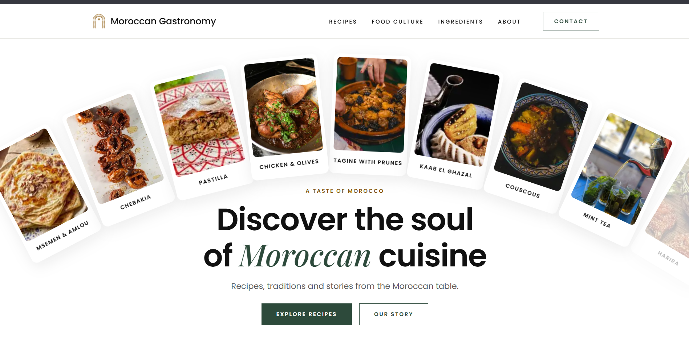

# Moroccan Gastronomy 🇲🇦

> Recipes, traditions and stories from the Moroccan table.

**Live site:** [www.gastromoroccan.com](https://www.gastromoroccan.com)

A fast, accessible and search-friendly website celebrating Moroccan cuisine: 16 traditional recipes, food culture stories and the essential ingredients of the Moroccan kitchen.



## ✨ Features

- **16 recipes** with ingredients, step-by-step instructions and video links
- **Food culture stories** in an editorial layout
- **Recipe feedback form** that emails the owner (Server Actions + Resend), with honeypot and timing anti-spam protection
- **Animated hero** with CSS motion paths, respecting `prefers-reduced-motion`
- **Fully responsive** with an accessible mobile menu (focus management, Escape key, scroll lock)

## 📊 Quality

| Lighthouse | Mobile | Desktop |
|---|---|---|
| Performance | 91 | 99 |
| Accessibility | 96 | 96 |
| Best Practices | 100 | 100 |
| SEO | 100 | 100 |

- **A+** security headers rating ([securityheaders.com](https://securityheaders.com))
- **Recipe & Article structured data** (Schema.org JSON-LD) for rich results in Google and AI assistants
- **Open Graph** previews for every recipe and story
- Auto-generated **sitemap** and **robots.txt**

## 🛠️ Tech stack

- **Framework:** Next.js 16 (App Router, Server Components, Server Actions)
- **Styling:** Tailwind CSS v4, CSS Modules
- **Animation:** Motion
- **Icons:** Lucide React
- **Email:** Resend
- **Hosting & analytics:** Vercel (Web Analytics, Speed Insights)
- **CI/CD:** GitHub Actions (lint + build on every PR), Dependabot, protected `main` branch

## 🚀 Getting started

```bash
git clone https://github.com/wiissal/gastro-moroccan.git
cd gastro-moroccan
npm install
```

Create a `.env.local` file at the root:

```env
RESEND_API_KEY=your_resend_api_key
FEEDBACK_TO_EMAIL=you@example.com
```

Then run:

```bash
npm run dev
```

Open [http://localhost:3000](http://localhost:3000).

## 📁 Project structure

```
src/
├── actions/      # Server Actions (feedback email)
├── app/          # Routes, layout, sitemap, robots
├── assets/       # Optimised images
├── components/   # Reusable UI components
├── data/         # Recipes, stories, ingredients, site config
└── lib/          # Structured data helpers
```

## 👩‍💻 Author

**Wissal**, full-stack developer
[LinkedIn]([www.linkedin.com/in/wissalouboujemaa]) · [Portfolio]([https://wiissal-portfolio.vercel.app/])